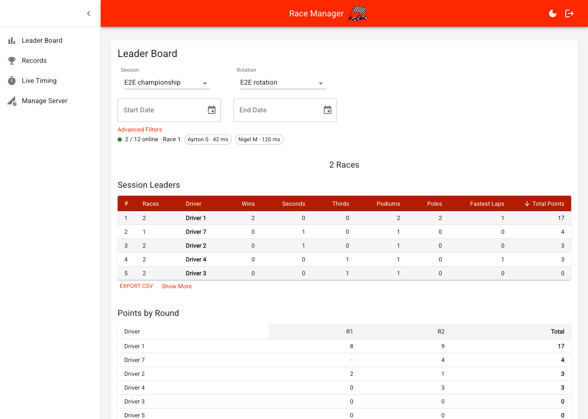
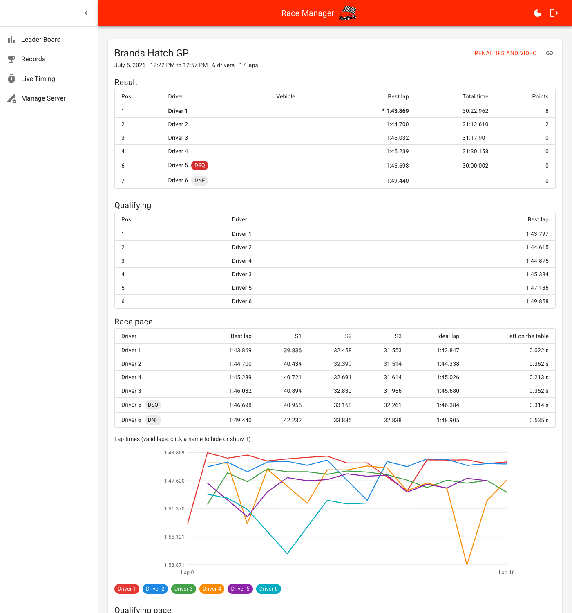
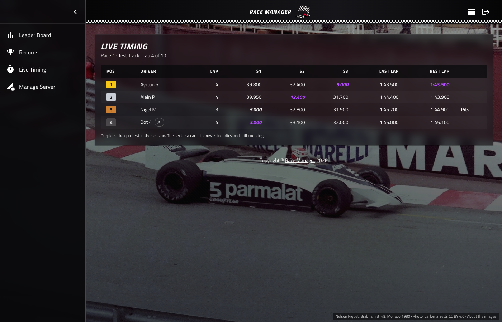
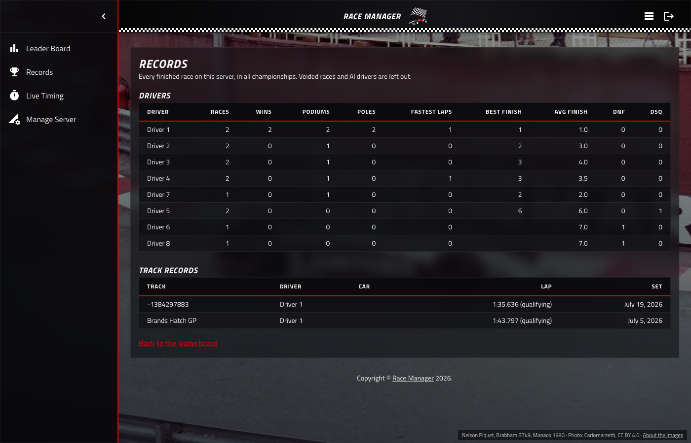
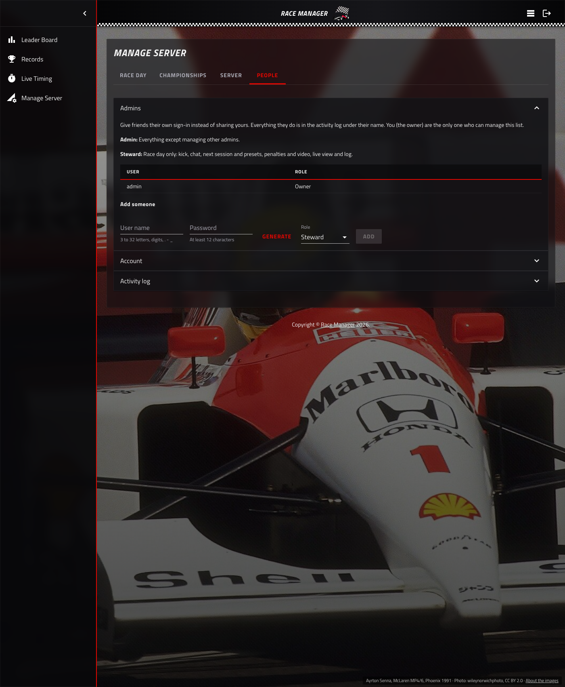

  
# Race Manager (RM)  
RM is an advanced (unofficial) [Automobilista 2](https://www.game-automobilista2.com/) server management interface. It supports online championships with permanent history tracking, easy rotation management/generation, general server management, etc. It's now easier than every to race with your friends and brag about your results (or blame them on someone else).  
  
  

This fork of [cauld/race_mgr](https://github.com/cauld/race_mgr) brings the stack up to date (Spring Boot 4, Java 21, React 19), hardens the security model, runs in Docker, and adds a lot of features. See the [changelog](CHANGELOG.md).

## What it does

**For everyone (no login):**
- **Leader Board**: championship standings with your own points table, pole and fastest-lap bonuses, dropped rounds, point adjustments and team standings; points by round; the race list; a fastest laps table; CSV export.
- **Race pages** you can share: result, qualifying, and (with the optional `ams2_stats` addon) sector times, the ideal lap and a lap-time chart; DSQ/DNF badges, penalties and a *Watch the race* link.
- **Driver pages**, **Records** (career totals, lap record per track) and **Live Timing** of the running session, plus who is online.

**For admins** (each person has their own sign-in; stewards get race-day tools only):
- Sessions (championships) and rotations, including a rotation builder; server settings (`server.cfg`), next-session settings and **presets**, advance the session.
- Live session: kick (with a temporary ban) and message players. Ban list, **whitelist**, balance of performance (ballast, power, drag), the game server log, an activity log.
- Penalties, disqualifications, voiding races, video links. Discord notifications.

**Runs** on Windows, or in Docker with the game server under Wine, or against a game server that runs elsewhere (a NAS, another container). MongoDB keeps the history; there are [backup scripts](#backups).

| | |
|---|---|
|  |  |
|  |  |

*(Screenshots are made from the committed sample races: `E2E_SCREENSHOTS=folder npm test` in `e2e/`.)*

### Contents
[Demos](#demos) · [Installation](#installationupgrade) · [Web UI access](#accessing-the-web-ui) · [Docker](#running-in-docker-linux--wine) · [Championships](#championships--scoring) · [Live session](#live-session) · [Game server elsewhere](#game-server-that-runs-somewhere-else-eg-its-own-container-on-a-nas) · [Admin tools](#admin-tools) · [Admins and stewards](#admins-and-stewards) · [Discord](#discord-notifications) · [Sector times](#sector-times-and-lap-by-lap-pace-optional-ams2_stats-addon) · [Backups](#backups) · [Settings (environment variables)](#windows-environment-variables) · [Developer setup](#developer-setup) · [API](#api-endpoints)
  
### Demos
 - Here is a [demo video](https://www.youtube.com/watch?v=Kuyp4uOb0OQ&t=13s) of Race Manager Server in action.
 - The original project's live [demo server](http://racemgr.ddns.net:8080/) showcases the non-admin stats view from some example races.

## Installation/Upgrade  
Official Race Manager releases/downloads can found on [the releases page](https://github.com/cauld/race_mgr/releases). With each new release you'll find 3 main files; an installer .exe, a standalone .exe and a .jar file. We'll cover their differences in the sections below.  

For reference, here is a [demo video](https://www.youtube.com/watch?v=EE4GzKiXl3Y) that walks through the setup step shown below.
  
### Prerequisites for all Installation Types
First, let's start with the prerequisites that are required by all installations. The following 4 items are required regardless of setup type:  
  
1. **Windows OS**, or Linux with Docker: the installer and `.exe` are for Windows (most testing is on Windows 10 & 11, the Windows installer has not been re-tested since the upgrade). On Linux, use the [Docker setup](#running-in-docker-linux--wine) instead, which also covers a game server that runs on a NAS or in its own container.  
2. **Automobilista 2 - Dedicated Server (AM2DS)**: Race Manager needs the game server's API and its files: put it on the same machine as [AM2DS](https://steamdb.info/app/1338040/z), or give it a shared folder or bind mount of the server's folder (see [Game server that runs somewhere else](#game-server-that-runs-somewhere-else-eg-its-own-container-on-a-nas)). Race Manager reads and writes files there: the rotation, `server.cfg`, the ban list and whitelist, the balance-of-performance files and the stats addon's data. In addition to installing AM2DS, you must also create a `server.cfg` file in the AM2DS installation directory (e.g.) `C:\Program Files (x86)\Steam\steamapps\common\Automobilista 2 - Dedicated Server`. Inside the AM2DS directory you'll find some sample configs in the `config_sample` sub-directory. You can start by copying one of those into the AM2DS parent directory (make sure to rename it to `server.cfg`). Alternatively, you can [download](https://raw.githubusercontent.com/cauld/race_mgr/main/sample_files/server.cfg) and use our starter config (back up the original one first just in case). You'll find a file called `UserGuide.pdf` in the AM2DS directory that explains the various configuration options. The most important one for Race Manager is `enableHttpApi`. This setting must be set to `true` for Race Manager to interact with the AM2DS APIs. Others you may want to tweak include GridSize (total driver count - human + AI) & MaxPlayers (number of humans before filling the rest with AI).
- (Optional) In the AM2DS `server.cfg` file, set `eventsLogSize` to a smaller value (e.g.) 1000. The default is something like 10000. One each pass RM checks and processes each record so the more there are the longer it takes to do so. We are capturing them in the mongo database at roughly 1s intervals. This recommendation is already applied if using our Race Manager starter config file.  
3. **Java 21+**: Race Manager requires a recent version of Java. If not already present on the machine, install the **Java 21 JDK**. Updated standalone JRE versions are no longer offered by the main Java projects. These days the JRE is bundled with the JDK. Any standard JDK from Oracle or OpenJDK should work fine. We find the version of OpenJDK offered by Amazon ([Corsetto](https://docs.aws.amazon.com/corretto/latest/corretto-21-ug/downloads-list.html)) easiest for most people because it offers an .MSI installer. Here is a [direct link](https://corretto.aws/downloads/latest/amazon-corretto-21-x64-windows-jdk.msi) for the .MSI download.  
4. **MongoDB**:  Race Manager uses MongoDB, a popular open source NoSQL database, to store race history data. Follow the [MongoDB Setup section](#mongodb-setup) below and then return back here to continue with the rest of the setup.  
  
### End User Installation  
In the section above we talked about the 3 different release files. For brand new end user installations you'll probably want the installer .exe. The installer does not handle any of the prerequisites so make sure to have completed that checklist first. The installer handles the installation of Race Manager like a traditional Windows application. It will create a Race Manager folder in `C:\Program Files (x86)`, collect important configuration information (e.g.) mongo password, set the required Windows environment variables and create a desktop icon for you (optional).  
  
Once installed simply use the installed `RaceManager.exe` (or shortcut) to launch Race Manager. The application starts a persistent console window that outputs various state messages during normal operation. You will *NOT* start AM2DS directly as Race Manager takes over operation, (i.e.) start/stop/restart, as needed.  
  
**NOTE:** If you want to stop Race Manager click on the console and then use the key combination `Ctrl + c`. Race Manager is meant to operate much like a background service, but doesn't actually register itself as a Windows service. To that end, closing the console window directly using the `X` doesn't actually close the application. That simply hides the output window. If you've closed the console window and now desire to close application itself then launch the Windows `Task Manager`, look for Race Manager in the `Processes` list, click on it and choose `End Task`.  Should you want to have Race Manager startup with Windows then [the following method](https://support.microsoft.com/en-us/windows/add-an-app-to-run-automatically-at-startup-in-windows-10-150da165-dcd9-7230-517b-cf3c295d89dd) can be utilized.  
  
#### End User Upgrade  
The easiest way to upgrade Race Manager is to stop the application and then simply replace the standalone .exe in your `C:\Program Files (x86)\Race Manager` folder with the latest one from the releases page.  
  
**NOTE:** You can also technically use the installer .exe to perform upgrades, but this isn't generally recommended. The installer is still pretty simple and as such doesn't yet retain previous configuration settings. It will also replace the previously generated application security secret which invalidates any existing authentication tokens (requiring users to clear their cookies and re-login).  
  
### Using the .jar File Instead  
`RaceManager.exe` wraps the Race Manager `.jar` file to bring a native Windows application look and feel, make it easy to launch, etc. If you prefer, you can also choose to run Race Manager directly from the released `.jar` file. You must set the required Windows environment variables manually first given that the installer normally does that (*see that section below*). With that done simply download the released `.jar` file, place it wherever you want, launch the Windows command prompt, browse to the location you placed the `.jar` and run `java -jar racemgr-x.x.x.jar` (where `x` is dependent on the version you downloaded). Then use `Ctrl + c` to stop the application as needed. To upgrade simply stop the application and replace the `.jar` file with the latest one from the releases page.  
  
### Accessing the Web UI  
As long as Race Manager is running, the main web application UI is available at http://localhost:8080/. General race data is available for browsing by anyone that can access the URL. If you are running this on your home network then by default that generally means just your computer. Admin related features like the creation/update of sessions & rotations, management of the underlying AM2DS, etc are secured behind the admin user/password that you created during installation (the *owner*). You'll have to login to access those features. The owner can give friends their own sign-in with fewer rights, see [Admins and stewards](#admins-and-stewards).
  
**SECURITY NOTE:** Race Manager listens on `127.0.0.1` (this computer only) by default. Set `RM_BIND_ADDRESS` (e.g. `0.0.0.0`) only if you deliberately want other machines to connect directly. Do **not** port-forward Race Manager's port straight to the Internet: it speaks plain HTTP, so the admin password and login token would travel unencrypted. To let friends browse results, put a TLS reverse proxy in front that forwards only the public paths and blocks `/api/v1/admin*` and `/api/v1/authenticate`, then log in as admin from the machine itself. Example (Caddy):
```
race.example.com {
    @admin path /api/v1/admin* /api/v1/authenticate
    respond @admin 404
    reverse_proxy 127.0.0.1:8080
}
```
Never forward the AM2DS HTTP API port (9000); Race Manager only needs it locally, so set `httpApiInterface : "127.0.0.1"` in `server.cfg` and remove the `Access-Control-Allow-Origin: *` header.

### Running in Docker (Linux + Wine)

An alternative to the Windows install: one container runs Race Manager, which launches the AMS2 dedicated server under Wine, plus a MongoDB container.

1. `cp .env.example .env` and fill it in (generate secrets with `openssl rand -hex 24`; the JWT secret needs `openssl rand -hex 32`).
2. `./docker/download-server.sh` downloads the dedicated server into `./ams2-server` with SteamCMD (anonymous login, no Steam account needed) and copies in the sample `server.cfg`. Edit that file's name and password.
3. `docker compose up -d --build`

What is exposed: the web UI only on `127.0.0.1:8080` (put a TLS reverse proxy in front, as described above); the AMS2 game ports `8766/udp`, `27015/udp`, `27016/udp`. MongoDB sits on an internal network with no published port, and the game server's HTTP API stays inside the Race Manager container. Admin login therefore happens from the Docker host itself (or through an SSH tunnel: `ssh -L 8080:127.0.0.1:8080 host`).

The Wine image is amd64 only. Update the game server by re-running step 2 and `docker compose restart racemgr`.

#### Or build the game server into the image

Instead of step 2, the build itself can download the game server: `./docker/build-with-server.sh` (after `cp .env.example .env`). It builds the `with-server` target of the `Dockerfile`, where SteamCMD downloads the server with an anonymous login, and starts the stack.

- If anonymous downloads ever stop working, pass a Steam user name (`./docker/build-with-server.sh <steam-username>`): it asks for the password and, if the account uses Steam Guard, the current code (neither is echoed). They reach SteamCMD as BuildKit secrets, so they are not stored in the image or its layers; only the server files are carried into the final image.
- On start the image copies the game server into the mounted `./ams2-server` folder (the folder that holds `server.cfg`, the ban list, the stats data and the rotation Race Manager writes), creating `server.cfg` from the sample. Later starts leave the folder alone, so your settings survive.
- To update the game server: run the script again, then once `RM_REFRESH_SERVER=true docker compose -f docker-compose.yml -f docker/docker-compose.with-server.yml up -d`. That replaces the game files but keeps `server.cfg`, the ban list and whitelist, the balance-of-performance files, `lua_config/` and the rotation file.
- **Keep that image on your machine.** It contains Reiza's server files, so never push it to a registry. A plain `docker compose up --build` still builds the normal image without them.
- Tested: the build stages and the copy-on-start logic on every push; the real anonymous download through the manual *Docker image* workflow run with *real_download* ticked.

#### Building on GitHub

`.github/workflows/docker.yml` builds the image on every push and pull request and checks it (Java and Wine are there, a start without game server files says so, and the `with-server` target copies stand-in server files in on first start and then leaves them alone). Every push publishes the tested images under the commit (`ghcr.io/<owner>/race_mgr:sha-1234567` and `ghcr.io/<owner>/race_mgr-external:sha-1234567`; no game server files in either). Pushing a version tag such as `v1.0.0` builds nothing: it gives the images already tested for that commit the version name (and `latest`), within a minute, so a release is exactly what was tested. Push the commit to a branch before tagging it.

The `with-server` image is never published, on purpose: it holds Reiza's server files, so publishing it would redistribute them. A manual run of the workflow (*Run workflow*, tick *real_download*) builds it with the real download to check it still works, and throws it away. Every push also runs the NAS setup for real: the external image as user 1029:100 with a separately mounted `server.cfg` and a real MongoDB, signing in and saving settings.

## Racing look

Race Manager starts in a **racing look**: dark carbon panels, a chequered flag along the top bar, motorsport type, gold, silver and bronze position badges, a championship podium, timing colours like on TV (purple for the quickest), and photos of Emerson Fittipaldi, Nelson Piquet, Ayrton Senna and Michael Schumacher in their cars slowly changing in the background. The button next to the sign-in icon switches to the classic light/dark look; each browser remembers its own choice.

The photos are freely licensed pictures from Wikimedia Commons (CC0, CC BY and CC BY-SA), resized for the web and served by Race Manager itself. The photo on screen is always credited in the corner, and *About the images* (`/about-images`, also `public/skin/CREDITS.txt`) lists the photographers, licences and originals. The drivers, teams and sponsors shown don't endorse Race Manager.

## Championships & scoring

A **session** is a championship: its standings are the "Session Leaders" table, and "Points by Round" shows every driver's points in each race (round) plus the total. Rounds are numbered in the order the races were run.

Each session chooses how points are awarded under *Manage Server → Scoring*: the original built-in formula, a preset (F1 style, F1 2003-2009, Top 10) or your own table of points per finishing position, plus optional pole position and fastest lap bonuses. Changing the scoring re-scores every race in the session, past ones included.

The same dialog sets the championship rules:

- **Dropped rounds**: each driver's lowest N scores don't count (a round they missed counts as 0 and is dropped first). Dropped scores show struck through in *Points by Round*.
- **Point adjustments**: manual corrections such as `Ayrton S, -5, track limits`, added after drops.
- **Teams**: `Red Team: Ayrton S, Alain P` per line adds a *Team Standings* table (a team's points are its drivers' totals).

An admin can add **penalties** to a finished race from its page (*Penalties and video*): a number of seconds added to a driver's race time, or a disqualification. The result is re-ordered when the page is shown (finishers by laps then time, then the others as the game server gave them) and points follow, so standings, rounds, driver pages and CSV all agree; the game server's own record is never changed, and removing the penalty puts everything back. The same dialog sets a **video link** (https YouTube or Twitch only), shown to everyone as *Watch the race*.

Which championship and rotation new races belong to is set under *Manage Server*: select both and press **Set active**, which changes nothing on the game server. **Update Server** does the same and also writes the rotation into the game server's rotation file (replacing the one it runs from its next restart, see Custom rotations). Until one is set, the leaderboard says *Not set up yet*.

An admin can **void** a race from its row in the race list. It stays visible, marked *Void*, but no longer counts towards standings, rounds or fastest laps; *Restore race* brings it back. *Export CSV* buttons save the standings and the points-by-round grid. Click a driver in the standings for their own page (results round by round, wins, podiums, poles, best and average finish). The same settings are available through the API (`scoring` on `POST`/`PUT /api/v1/admin/race/session`).

## Live session

When the game server is running with its HTTP API enabled, Race Manager shows who is connected:

- **Everyone** sees an "N / max online" strip on the Leader Board with the stage and player names and ping. Steam IDs and internal ids are never sent to the public endpoint.
- **Admins** get a *Live Session* panel under *Manage Server* with each player's Steam ID, a **Kick** button (with confirmation, optionally with a temporary ban of 10 minutes to 30 days) and a box to send a chat message to the session.

The game server treats kick and chat as admin actions and by default only accepts them from `127.0.0.1`, which is where Race Manager runs.  Bans are the game server's own temporary bans (a number of seconds), so they last until they expire. All of this goes through `/api/v1/gameserver/session` (public), `/api/v1/admin/gameserver/session`, `/api/v1/admin/gameserver/kick` and `/api/v1/admin/gameserver/chat` (admin).

### Live timing

**Live Timing** in the menu is a page for everyone (it refreshes every 3 seconds): the cars of the running session in race order with lap, the three sector times, last and best lap, and the quickest of each marked in green, plus the stage, track and "Lap 4 of 10". It reads the game server's own session status, names only (`/api/v1/gameserver/timing`, public).

## Records

**Records** in the menu totals every finished race on the server across all championships: per driver the races, wins, podiums, poles, fastest laps, best and average finish, retirements and disqualifications, and the quickest lap ever set at each track (race or qualifying). Voided races and AI drivers are left out. Points are not totalled there because each championship scores differently.

## Game server that runs somewhere else (e.g. its own container on a NAS)

Race Manager doesn't have to launch the game server. Set `RM_GAMESERVER_CONTROL=external` and it leaves starting, stopping and restarting to whatever runs the server. In this mode:

- "Running" means the game server's HTTP API answers. The Manage Server page hides Start/Stop and shows a notice, and after you change the rotation you restart the game server yourself.
- Race Manager still needs the server's files (a shared folder or bind mount) to read `lua_config/sms_stats_data.json` and to write the rotation files, so point `RM_PATH_TO_DEDICATED_SERVER` at it.
- If the game server's API isn't reachable from `127.0.0.1` (where it trusts local callers as admin), give Race Manager the API user from `httpApiUsers` with `RM_GAMESERVER_USER` and `RM_GAMESERVER_PASSWORD`. The game server speaks plain HTTP, so only do that on a network you trust.

`docker/docker-compose.external-server.yml` is a ready example (Race Manager plus MongoDB, both on the host's loopback). It pulls the published image named by `RACEMGR_IMAGE` in `.env`, so the file works on its own; to build the image from the repository instead, add `-f docker/docker-compose.external-build.yml` and `--build`. It assumes the game server container uses host networking and keeps its API on `127.0.0.1` via `httpApiInterface : "127.0.0.1"` in `server.cfg`.

### On a Synology NAS

Tested only on paper so far: nothing here has been run on a Synology yet. It needs DSM 7.2 or later with **Container Manager**, an x86 model, and a game server container whose folder you can reach (for a DS1522+ with 24 GB, memory is no problem).

1. **MongoDB 7 needs a CPU with AVX.** Over SSH: `grep -c avx /proc/cpuinfo`. Anything above `0` is fine. If it prints `0`, change the `mongo:` image in the compose file to `mongo:4.4`, and expect to test that yourself.
2. Make a folder, e.g. `/volume1/docker/racemgr`, and put in it the `docker/docker-compose.external-server.yml` file and the `docker/mongo-init` folder, side by side, plus a `.env` (copy `.env.example`, generate the secrets with `openssl rand -hex 24`).
3. In `.env` set `AMS2_DATA_DIR` to the game server's folder (e.g. `/volume1/docker/ams2`), and `RACEMGR_UID` / `RACEMGR_GID` to that folder's owner: `ls -ln /volume1/docker/ams2`. On a Synology these are like `1026` and `100`, not 1000. Set `RACEMGR_IMAGE=ghcr.io/<owner>/race_mgr-external:<version>` (published when a version tag such as `v1.0.0` is pushed to GitHub), so the NAS pulls a ready image instead of compiling one.
   If your game server keeps `server.cfg` outside its folder and mounts it on its own (a line like `- /volume1/docker/ams2-server/server.cfg:/home/steam/ams2_server/server.cfg` in its compose file), the copy inside the folder is just an empty placeholder: uncomment the matching `server.cfg` line in Race Manager's compose file so it edits the real one.
4. Container Manager → **Project** → Create, pick that folder and the compose file. It pulls the images and starts Race Manager and MongoDB. Race Manager listens on the NAS's `127.0.0.1:8080`.
5. Race Manager reaches the game server's API at `127.0.0.1:9000` because the compose file uses the host network; that works when the game server container uses the host network too. If it doesn't, set `RM_GAMESERVER_HOST` to the NAS address and give it the API user and password (`RM_GAMESERVER_USER` / `RM_GAMESERVER_PASSWORD` in the compose file).
6. For friends, use DSM's reverse proxy (Control Panel → Login Portal → Advanced → Reverse Proxy) to give `localhost:8080` an HTTPS name, and set `RM_COOKIE_SECURE=true`.
7. Back up MongoDB regularly with `docker/backup-mongo.sh` from a Task Scheduler job (run it as root; first `export COMPOSE_FILE=docker/docker-compose.external-server.yml`).

## Admin tools

*Manage Server* has four tabs: **Race day** (live session, next session settings and presets, game server log), **Championships** (sessions, scoring, rotations, the rotation builder, *Set active* and *Update Server*), **Server** (server.cfg, ban list, whitelist, balance of performance) and **People** (admins, your account, activity log). Stewards only see *Race day* and their account. The tab is kept in the address (`/manageserver?tab=server`). Each tool opens on its own:

- **Server settings (server.cfg)** edits the server name, password, player and grid limits, session lengths, AI difficulty and a few switches. Only the value after each setting is replaced: comments and everything else in the file stay exactly as they were, and the previous version is kept as `server.cfg.bak`. The game server reads the file at start-up, so restart it to apply. The password is never shown, only whether one is set.
- **Rotation builder** builds a rotation by hand: a default setup with every session setting the game server offers, then the rounds in order (track, cars, and any setting a round changes), with move and remove buttons. Start from a saved rotation or import a rotation file, and export the result in the game server's own file format to share it. Saving only stores it; it goes live when you select it and use *Update Server*. Rotations are checked before they are written (known settings, simple values, at most 200 rounds).
- **Next session settings** sets up the *next* session without restarting the game server, with the same full editor as the rotation builder: every setting the game server offers. Only what you set is sent (names such as `FULL` or `Clear` are turned into the numbers the game server's API takes, using its own lists), and it can advance the running session to its next stage. A rotation may set the track again when the next session starts. **Presets**: *Save preset* stores those settings under a name (the same name replaces that preset, up to 50); *Apply* in the saved list sends them in one click, *Edit* loads them back into the editor. A preset only applies settings, it never advances the session: use *Advance to next stage* for that. Admins save and delete presets; stewards can apply them. In the rotation builder, *Race next* on a round sends that round (the default setup with its changes) to the next session the same way. *Save as preset* on a round, or *Save every round as a preset*, turns rounds into presets (named like `Season 1 · 2 · Interlagos`), so a rotation's races can be run one at a time from the preset list.
- **Ban list** edits the game server's permanent ban file (`blacklist.cfg` in its folder) in the server's own layout: a `[ ... ]` list with one Steam ID per line and optional `// notes`. Header comments and the rest of the file are kept. It refuses a file with any other layout instead of risking damage. The game server reads the file when it loads its configuration, so restart it for a change to be sure to apply.
- **Whitelist** edits the game server's `whitelist.cfg` the same way. The game server only uses it when `server.cfg` has `whiteList : { "whitelist" : "whitelist.cfg" }`: from then on **only the listed players can join** (and the ban list is ignored), which is how you run a closed league. Race Manager tells you whether the server is using the list and warns when it is, because an empty list in use lets everybody in. Restart the game server for a change to be sure to apply.
- **Game server log** shows what the game server itself recorded recently (joins, leaves, stage changes, chat, results), newest first, with a filter. Values are always shown as plain text.
- **Balance of performance** edits per-driver ballast (kg), engine power and drag in the game server's `driver_ballast.json`, `driver_power_scalar.json` and `driver_drag_scalar.json` (or the file names given in `server.cfg`). One table, one row per Steam ID, empty cell = default; names of players who are connected right now are shown next to their Steam IDs. Values are range-checked (ballast 0-500 kg, power and drag 0.5-1.5), unknown keys in your files are kept, and the previous files are kept as `.bak`. Restart the game server to apply.
- **Activity log** lists recent admin actions (logins, kicks, settings, scoring, rotations, password changes), kept for 180 days.
- **Admins** (owner only) gives friends their own sign-in, see below.
- **Account** changes your own password (12 characters or more). For the owner it's stored hashed in the database, overrides `RM_ADMIN_PASSWORD`, and signs every other device out; for everyone else it signs out their other devices. If you ever lock yourself out, start Race Manager once with `RM_ADMIN_PASSWORD_RESET=true` to go back to `RM_ADMIN_PASSWORD`.

Everyone can open a single race at `/race/<id>` (the link button next to each round in the race list copies it) and see the **Fastest Laps** table, the quickest lap at each track from qualifying or the race.

## Admins and stewards

The account from `RM_ADMIN_USER` is the **owner**. Under *Manage Server → Admins* the owner adds people, each with their own user name and password (3 to 32 letters, digits, `.`, `-`, `_`, not case sensitive; the password is chosen or generated by the owner and shown once; up to 20 people):

| Role | Can do |
|---|---|
| **Steward** | Race day: see who is online, kick (with a temporary ban) and message players, change the next session and apply presets, advance the session, give penalties and video links, read the game server log, change their own password |
| **Admin** | Everything a steward can, plus the server settings, rotations, championships and scoring, ban list, whitelist, balance of performance, void races, start/stop, activity log |
| **Owner** | Everything, plus adding, changing and removing the others. There is exactly one owner |

Changing someone's role, resetting their password or removing them takes effect immediately: a removed or reset person is signed out at once. Everything people do is in the activity log under their own name. The rules are enforced by the server per URL (`WebSecurityConfig`): a new admin endpoint needs the admin role until it is explicitly listed for stewards, and the pages simply hide what a role can't use. If the database can't be read, only the owner can sign in. If the owner forgets the password, `RM_ADMIN_PASSWORD_RESET=true` as before.

## Discord notifications

Set `RM_DISCORD_WEBHOOK_URL` to a Discord channel webhook (`https://discord.com/api/webhooks/...`) and Race Manager posts the podium and fastest lap when a race finishes, and a notice when the game server goes offline or comes back. Only races that finished in the last 30 minutes are announced, so importing old history never floods the channel. Messages can't ping anyone whatever a driver is called. Leave it unset to turn this off.

## Sector times and lap-by-lap pace (optional `ams2_stats` addon)

Reiza's `sms_stats` addon records results only. The community [`ams2_stats`](https://github.com/devology-uk/ams2-dedicated-server-toolbox) addon (from the AMS2 Dedicated Server Toolbox, MIT licence) also records every lap with its sector times, lap validity and DNF/disqualified states. Race Manager can read its output instead of `sms_stats`:

1. Copy the addon's `ams2_stats` folder into the game server's `lua` folder and add `"ams2_stats"` to `luaApiAddons` in `server.cfg` (you can drop `sms_stats`: use one stats source, not both, or races would count twice).
2. Start Race Manager with `RM_STATS_SOURCE=ams2_stats`. The addon writes local times without a time zone, so also set `RM_STATS_TIMEZONE` (for example `Europe/London`) to the zone the game server's clock is in; the default is the zone Race Manager runs in.
3. Each finished `Race1` session becomes a race (with the `Qualifying1` before it when there is one). Each race's page then shows **sector times** per driver (best lap, the three best sectors, the *ideal lap* made of them and what was left on the table, with the quickest sector of each marked) and a **lap-time chart** for the race and for qualifying, where you can click a name to hide it.

Whichever stats source is used, a **disqualified** driver keeps their place in the result but scores no points, and a driver who **retired** before 90% of the winner's distance scores none either. Retirements are shown as DNF and disqualifications as DSQ on the race page.

## Backups

All race history lives in MongoDB. With the Docker setup, `docker/backup-mongo.sh [folder] [how-many-to-keep]` writes a compressed archive (default `./backups`, newest 14 kept) and is safe to run from cron, for example every night at 03:00: `0 3 * * * /path/to/race_mgr/docker/backup-mongo.sh /path/to/backups 30`. For the external-server compose file run `export COMPOSE_FILE=docker/docker-compose.external-server.yml` first. Copy the archives off the machine too.

To go back to a backup: `docker compose stop racemgr`, `docker/restore-mongo.sh backups/racemgr-<date>.archive.gz` (asks you to type `yes`, because it replaces everything now in the database), then `docker compose start racemgr`. Without Docker, use `mongodump --archive --gzip --db racemgr` and `mongorestore --archive --gzip --drop` against your own MongoDB.

## Troubleshooting Tips
- If the console window appears and disappears immediate after launch, there is likely a configuration error (i.e.) something incorrect with the values you supplied to the installer and/or entered directly into the required Windows environment variables. For example, Race Manager is unable to connect to Mongo because the wrong password was supplied. It could also be a Java version mismatch (installing from the link provided above would rule this problem out).
  
## Additional Setup Information  
  
### MongoDB Setup  
- Unless you plan to use a remote MongoDB, install MongoDB now. Any recent version (5.0+) should work fine. The [free community edition](https://www.mongodb.com/try/download/community) is all you need.  
- Say yes to running MongoDB as a service so that you don't have to start/restart manually when using Race Manager.  
- MongoDB is not secure by default. Race Manager requires authentication, so next we'll add a user and enable authentication:  
  - Open the Windows Command Prompt  
  - Browse to Mongo install directory (e.g.) `cd C:\Program Files\MongoDB\Server\6.0\bin`    
  - In the Windows Command Prompt, run `mongo` to start the Mongo Shell.  
 - For Mongo 6.X:  
      - The mongo shell is removed from MongoDB 6.0. The replacement is mongosh which requires a seperate [download](https://www.mongodb.com/docs/mongodb-shell/install/#install-from-msi) / install.  
      - In the Windows Command Prompt, run `mongosh` to start the Mongosh Shell.
 - For Older Mongo 5.X Installations:    
      - Next we'll launch Mongo Shell to add a user for the Race Manager database (NOTE: the database itself is created automatically later when the app is launched).  
 - The rest of the steps are the same regardless of MongoDB version. So next we'll switch to the `admin` auth database and create your user. Run the following commands and you will be prompted for the password you'd like to use (**NOTE**: Do not use the special characters `@` or `:`):  
 ```
 use admin    
 db.createUser( { user: "racemgr", pwd:  passwordPrompt(), roles: [ { role: "readWrite", db: "racemgr" } ] } )   
 ```  
- From the same shell, you can test the user with the following command, `db.auth("racemgr", passwordPrompt())`. A return value of `1` is good.  
- Type `quit` and hit enter to exit the mongo/mongosh shell and return the Windows command prompt.  
- Back in the Mongo install directory, open `mongod.cfg` in a text editor (NOTE: to save the updated file you will need admin privileges).  
- Look for the `security` section which is commented out by default. Uncomment and enable security like so:  
```    
security:
  authorization: "enabled" 
 ```
 - Now restart the "MongoDB" service using the "Services" tab in Windows Task Manager or just reboot your machine.  
- That's it. Return to [installation section](#end-user-installation) above.  
  
### Windows Environment Variables  
When using the installer .exe the required Windows environment variables will be set for you. Otherwise, you will need to [manage these yourself](https://geekflare.com/system-environment-variables-in-windows/).  
  
- `RM_GAMESERVER_HOST`: Host running dedicated game sever (i.e.) `localhost`  
- `RM_GAMESERVER_PORT`: Host running dedicated game sever (i.e.) `9000` (unless you customized)  
- `RM_PATH_TO_DEDICATED_SERVER`: The local filesystem path to which you've installed AM2DS (e.g.) `C:\Program Files (x86)\Steam\steamapps\common\Automobilista 2 - Dedicated Server`  
- **NOTE**: Don't use quotes, the path is escaped internally  
- `RM_MONGO_USER`: The username you set when creating the user during the mongo setup. If you follow the directions exactly, then `racemgr` was the default value.  
- `RM_MONGO_PASS`: That password you set when creating the user during the mongo setup  
- `RM_MONGO_HOST`: Use `localhost` if you are running on the same machine  
- `RM_MONGO_PORT`: Use the mongo default port, (i.e.) `27017`, unless you've customized  
- `RM_ADMIN_USER`: All `admin` features/API endpoints require authentication (a JWT, sent as an HttpOnly cookie by the web UI or as a `Bearer` token by API clients). Set to whatever you want the admin username to be.  
- `RM_ADMIN_PASSWORD`: Set to whatever you want the admin password to be.  
- `RM_GAMESERVER_CONTROL` (optional): `external` when something else runs the game server (see above).  
- `RM_GAMESERVER_USER` / `RM_GAMESERVER_PASSWORD` (optional): HTTP basic auth for the game server's API.  
- `RM_STATS_SOURCE` (optional): `ams2_stats` to read the `ams2_stats` addon's file instead of `sms_stats` (see Sector times). `RM_STATS_TIMEZONE` (optional): the time zone of the game server's clock, e.g. `Europe/London`.  
- `RM_DISCORD_WEBHOOK_URL` (optional): a Discord webhook for race and server notifications (see Discord notifications).  
- `RM_ADMIN_PASSWORD_RESET` (optional): `true` for one start to discard a password changed in the UI.  
- `RM_COOKIE_SECURE` (optional): Set to `true` when a TLS proxy in front connects to Race Manager over plain HTTP, so the session cookies are marked `Secure`.  
- `RM_BIND_ADDRESS` (optional): Address to listen on, default `127.0.0.1`. `RM_PORT` (optional) changes the port, default `8080`.  
- `RM_JWT_SECRET`: This is used as part of user authentication. It must be a random string of at least 32 characters (64 recommended) that is unique to each installation. Generate it locally (e.g. `openssl rand -hex 32`), not with an online tool. Admin logins last 12 hours by default; set `RM_JWT_VALIDITY_HOURS` to change that. After 5 failed logins from one address, further attempts are refused for 15 minutes. We recommend using [this tool](http://www.unit-conversion.info/texttools/random-string-generator/) to generate one.  
  
## Developer Setup  
If you are looking to add or enhance features, fix bugs, etc then this is the section for you. The core prerequisites remain the same so start by following that section above and then return here.  
  
### Frontend  
- TypeScript/React/Redux/NodeJS are used to develop the frontend single page application (SPA). You will need to install the latest version of [NodeJS](https://nodejs.org/en/download/) in addition to the other prerequisites outline above.  
- The frontend source is located at `src/main/client`. There is a `README` file there with more details. During development you generally start the backend and then also start the frontend separately using `npm run start` from the client director. This makes all the standard React tooling available for development. The development UI loads at `http://localhost:3000`. It internally proxies API requests to the backend running on port `8080`.  
- During the normal application build process the frontend bundle is produced and copied into the `.jar` for hosting during general usage.  
  
### Backend  
- Java is used to develop the backend of Race Manager.  
- [Spring Boot](https://spring.io/projects/spring-boot) is the main framework in use.  
  
### Tests

- `./mvnw package -P '!windows-dist'` runs the lint, type check and Vitest tests of the web UI, the Java tests, and builds the jar.
- `e2e/` holds the **end-to-end tests**: they start the real jar with a throwaway MongoDB (Docker), a stand-in for the game server's HTTP API and a headless Chrome, import the races from the committed `ams2_stats` sample and click through the app (sign-in, standings, race pages, sector times, penalties, ban list, whitelist, server settings, kick). Build the jar first, then `cd e2e && npm install && npm test`. Set `CHROME_PATH` if Chrome is not in the usual place, or `E2E_MONGO_URI=mongodb://host:port` to use a MongoDB you already have instead of Docker. A failing scenario leaves a screenshot in `e2e/artifacts/`.
- `.github/workflows/ci.yml` runs both on every push.

### Application Builds  
- Maven is used manage the Java Dependencies and build the whole application.  
- A Maven plugin is used to integrate [Launch4j](https://launch4j.sourceforge.net/) for wrapping the `jar` as a lightweight Windows native executable.  
- [Inno Setup](https://jrsoftware.org/isinfo.php) is then used to create a Windows installer from Launch4j's resulting `.exe`. This part is still manual. The installer project file is `installer/racemanager.iss`.  
  
### Additional Notes:  
- The server log (`race_mgr.log`) lands in whatever system directory is defined in the Windows `TEMP` environment variable  
  
## API Endpoints  
- All API endpoints start with `/api/v1/` (e.g.) `http://localhost:8080/api/v1/rotation`  
- All server admin related features live under the `/api/v1/admin/` resource (e.g.) `http://localhost:8080/api/v1/admin/...`. These require Bearer (JWT) authentication.  
  
## API Exploration (Postman)  
- Download/Install [Postman](https://www.postman.com/downloads/)  
- [Import collection & environment](https://learning.postman.com/docs/getting-started/importing-and-exporting-data/) found in the `postman` directory  
- Open the collection, select the `RaceMgr` environment, click on the `Admin` folder in the collection and update the admin user/password values. Make sure to save after updating. More on managing environments [here](https://learning.postman.com/docs/sending-requests/managing-environments/).  
- Use APIs against running server  
- Here is a [demo/explanation video](https://www.youtube.com/watch?v=LBpREwPQ514) of our APIs and Postman usage.

## Custom rotations
- Build one in the web UI: *Manage Server → Rotation builder*. The **default setup** offers every session setting the game server describes about itself (78 of them on a current server: grid and AI, cars and multi-class, flags such as ABS and the pit speed limiter, damage, tyre wear, fuel, penalties, rolling starts and formation laps, mandatory pit stops, date, time and weather for practice, qualifying and the race...), grouped, each with the right control and the server's own description on hover. A setting that is not set is left to the game. Then the **rounds**, in order: each has its track, optionally its own cars, and *Round settings* for anything it changes. Import or export the game server's own file format. The settings come from the game server (`/api/v1/admin/gameserver/schema`), so a game update that adds settings shows them without a Race Manager update; if the server isn't answering, the settings already in the rotation are still shown as plain values.
- Or send one to the API (`POST /api/v1/admin/race/rotation`); the Postman collection has examples, including a set of sample F1 rotations in `sample_files/rotations`.
- **Bring your server's current rotation in:** *Import file* in the Rotation builder takes the game server's own file (the live one is `lua_config/sms_rotate_config.json`, the default `lua/sms_rotate/sms_rotate_default_config.json`). It reads them the way the server does (comments, bare keys like `version : 7`, trailing commas), and rotations that pick the cars per round need no class for the whole rotation. Everything the builder doesn't edit (grid, AI, damage, pit stops, numeric weather and flag values, extra weather slots, `persist_index`) is kept exactly, so importing and saving changes nothing.
- **What *Update Server* does to the game server's files:** it writes the selected rotation to `lua/sms_rotate/sms_rotate_default_config.json` and deletes `lua_config/sms_rotate_config.json`, so the rotation addon rebuilds its working copy from it at the next start. Import your current rotation (or back that file up) before the first *Update Server*, or it is gone.
- Rotations are checked before they are written: every setting must be one the game server lists as writable for a session (except the `ServerControls*` switches), numbers fit in 32 bits (counts and lengths 0 to 1000), text is plain, at most 200 rounds.

## Not built yet
- A race calendar with sign-ups (it needs a way to tell friends apart without giving everyone an account).
- Driver ratings and licences, with a minimum-licence rule.
- Mod cars and tracks, installing or updating the game server from the web UI, several game servers in one Race Manager.
- A *Restart game server* button for a game server that runs elsewhere. The game server's API has an `api/restart` method whose documentation just repeats the text of `api/session/advance`, and it needs the server's API user, so what it really does is untested.
- Track and car images.
